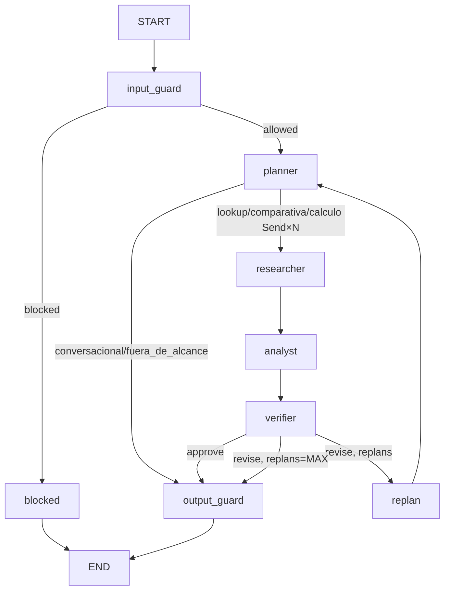

# Grafo multi-agente (RAG agéntico)

## 1. Qué es, en lenguaje de negocio

El módulo agéntico recibe la pregunta de un analista o inversionista, la planifica, busca evidencia en el corpus de reportes y redacta una respuesta en español con cada cifra vinculada a la página de donde proviene. Si una cifra no puede respaldarse con el corpus, no se incluye. Si se detecta un intento de manipulación del sistema, la pregunta se bloquea antes de llegar al LLM.

## 2. Cómo encaja en la arquitectura

```
Usuario → API /api/chat → runner.py → runner_real.py
                                         ↓
                                    grafo LangGraph
                                         ↓
                              ┌──────────────────────┐
                              │ tools.py (retrieval) │
                              │ RETRIEVAL_MODE=direct │
                              │   o mcp (vía /mcp)   │
                              └──────────────────────┘
```

Recibe: `(session_id, message)` vía `run_chat`.
Entrega: `AsyncIterator[SSEEvent]` al API, que los transmite al frontend como Server-Sent Events.
Habla con: `indexstore.py` (via retrieval/core.py en modo direct) o el servidor MCP en `/mcp`.

## 3. Nodos del grafo y su tipo

| Nodo | Tipo | Descripción |
|------|------|-------------|
| `input_guard` | determinista + LLM | Valida longitud, detecta inyecciones regex, enmascara PII, invoca MODEL_GUARD para safety check |
| `planner` | LLM (1 llamada) | Genera el Plan con intent, entity y subqueries a partir de la pregunta y el catálogo |
| `researcher` (×N) | agente (≤3 tool_calls) | Busca evidencia para una SubQuery; emite tool_call/tool_result SSE via get_stream_writer |
| `analyst` | agente (≤3 tool_calls) | Redacta respuesta con evidencia envuelta en \<documento\>; tools: calculate, check_identities, get_page |
| `verifier` | determinista + LLM opcional | Verifica chunk_ids, normaliza cifras, detecta números sin respaldo |
| `output_guard` | determinista | Bloquea recomendaciones, agrega aviso, convierte [chunk_id] → [n], construye Citations |
| `replan` | determinista | Incrementa contador de replans y limpia findings/evidence/draft |
| `blocked` | determinista | Escribe final_answer con el motivo de bloqueo del guard |

### Mermaid del grafo (GRAPH_MODE=full)



En `GRAPH_MODE=simple` el fan-out es secuencial (`researcher_seq`) y procesa solo la primera SubQuery.

## 4. Decisiones y alternativas descartadas

| Decisión | Alternativa descartada | Razón |
|----------|----------------------|-------|
| Verificador determinista primero | Solo LLM | El LLM puede alucinar en la verificación; las reglas numéricas son exactas |
| `get_stream_writer` para SSE intra-nodo | `astream_events` | Más simple de consumir en el runner; no requiere parsear tipo de evento |
| Enmascarar PII antes del LLM | Bloquear si hay PII | La pregunta puede seguir siendo válida; la PII se reemplaza sin perder semántica |
| `MemorySaver` para historial | Sin checkpoint | Habilita contexto de conversación multi-turno sin base de datos adicional |
| evidence envuelto en `<documento id>` | Sin etiquetas | Separar datos de instrucciones reduce el riesgo de inyección en el prompt del analista |
| `GRAPH_MODE=simple` como plan B | Reintentar en full | Si hay problemas de concurrencia o latencia, el modo simple da la misma calidad con menos llamadas |

## 5. Contrato que toca (SPEC)

- §Modelos de los agentes: GuardResult, Plan, SubQuery, Filters, Finding, Calculation, Draft, Verification, Citation, GraphState
- §Runner: `run_chat(session_id, message) → AsyncIterator[SSEEvent]`; RUNNER_MODE, GRAPH_MODE
- §Eventos SSE: order status → plan → tool_call/tool_result → finding → verification → token* → citations → done
- §Límites: MAX_SUBQUERIES=4, MAX_TOOL_CALLS_RESEARCHER=3, MAX_TOOL_CALLS_ANALYST=3, MAX_REPLANS=1, TIMEOUT_S=45
- §Normalización: cifras de evidencia y draft se comparan con normalize_number (SPEC §Normalización)

## 6. Límites y qué cambiaría en producción

- **TIMEOUT_S=45**: en producción, monitorizar p95 y bajar THINKING_ANALYST si supera 30 s.
- **MemorySaver en memoria**: en producción, sustituir por un checkpointer persistente (PostgreSQL o Redis) para sobrevivir reinicios de Cloud Run.
- **MAX_REPLANS=1**: suficiente para correcciones simples; en corpus con tablas ambiguas podría subir a 2.
- **LLM_CONCURRENCY=8**: controla los semáforos de Gemini; ajustar según cuota de la API key.
- **Inyección**: las reglas regex cubren patrones conocidos; en producción añadir un modelo clasificador fine-tuneado.

## 7. Cómo probarlo

### COMPUERTA A (fakes — sin red):
```bash
uv run pytest tests/test_graph.py -v
# 21 tests: normalización, AST, inyección, secuencia canónica, grafo con fakes
```

### COMPUERTA C3 (real — requiere índice y GEMINI_API_KEY):
```bash
RUNNER_MODE=real RETRIEVAL_MODE=direct \
  uv run python -m app.agents.cli "¿Cuál fue la utilidad neta en el 2T26?"
# Debe responder la cifra con [n] citando la página correcta
# Latencia objetivo: < 30 s; llm_calls ≤ 6
```

### Runner fake rápido:
```bash
RUNNER_MODE=fake uv run python -m app.agents.cli "¿Cuál fue la utilidad neta?"
# Emite la secuencia canónica de SSEEvents sin red
```
