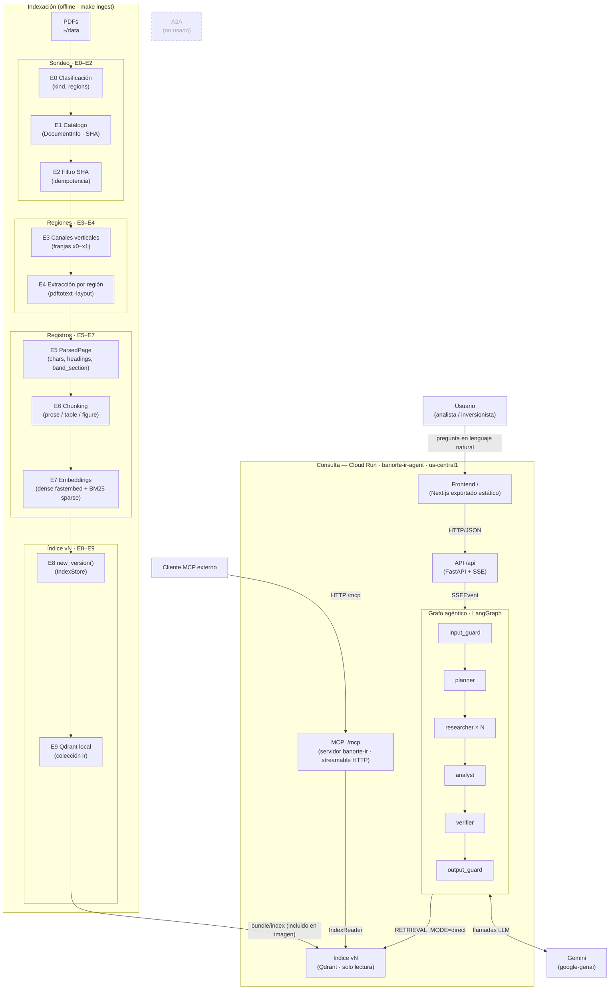

# Arquitectura — Chat RAG Agéntico de Relación con Inversionistas

## Diagrama

## Componentes

| Componente | Qué hace | Tecnología | Ruta | Doc |
|---|---|---|---|---|
| Sondeo (E0–E2) | Clasifica páginas, construye catálogo, filtra docs ya procesados | PyMuPDF, sha256 | `backend/app/ingest/` | `docs/indexing.md` |
| Extracción por región (E3–E4) | Detecta columnas, recorta con pdftotext -layout | pdftotext, canales verticales | `backend/app/ingest/` | `docs/indexing.md` |
| Chunking + Embeddings (E5–E7) | Produce ParsedPage, Chunk; vectoriza dense + BM25 | fastembed, BM25 propio | `backend/app/ingest/`, `backend/app/retrieval/` | `docs/indexing.md` |
| IndexStore (E8–E9) | Versiona índice, expone API de lectura thread-safe | Qdrant, os.replace | `backend/app/indexstore.py` | `docs/retrieval-mcp.md` |
| Retrieval + MCP | Búsqueda híbrida RRF, rerank opcional, servidor MCP | Qdrant, fastembed cross-encoder, MCP SDK | `backend/app/retrieval/`, `backend/app/mcp_server/` | `docs/retrieval-mcp.md` |
| Grafo agéntico | 6 nodos LangGraph: guard → plan → research × N → analyst → verify → guard | LangGraph, Gemini | `backend/app/agents/` | `docs/agentic-rag.md` |
| API | SSE streaming, health, documentos, archivos | FastAPI, sse-starlette | `backend/app/api/` | `docs/api.md` |
| Frontend | Chat UI estático servido desde Cloud Run | Next.js export | `frontend/` | `docs/frontend.md` |
| Despliegue | Imagen única: índice + frontend + API + MCP | Cloud Run, Docker | `deploy/`, `Dockerfile` | `docs/deploy.md` |

## Cómo viaja una pregunta (7 pasos)

1. **Usuario → Frontend**: el analista escribe la pregunta en el chat Next.js.
2. **Frontend → API**: `POST /api/chat {session_id, message}` inicia un stream SSE.
3. **API → input_guard**: valida la pregunta (longitud, idioma, instrucciones ocultas, temas fuera de alcance).
4. **planner → researcher**: el LLM descompone en ≤4 sub-consultas; cada researcher llama las tools MCP (`search_documents`, `get_page`).
5. **MCP → IndexStore → Qdrant**: búsqueda híbrida (denso + BM25, RRF, rerank opcional), regresa `SearchHit[]`.
6. **analyst → verifier**: el analista sintetiza los findings; el verificador comprueba cada cifra contra la evidencia (no inventa).
7. **output_guard → Frontend**: emite `token*`, `citations`, `done`; el frontend renderiza la respuesta con referencias a página.

---

## Cifras medidas en producción (Cloud Run · gemini-3.8-flash · GRAPH_MODE=full)

| Métrica | Valor |
|---|---|
| `llm_calls` típico por pregunta | 18–22 |
| `tool_calls` típico por pregunta | 10–14 |
| Citas por respuesta | 5–9 |
| Latencia P50 | ~50–90 s |
| Timeout configurado | 120 s |
| Memoria imagen Docker | ~95 MB (índice + PDFs + código) |
