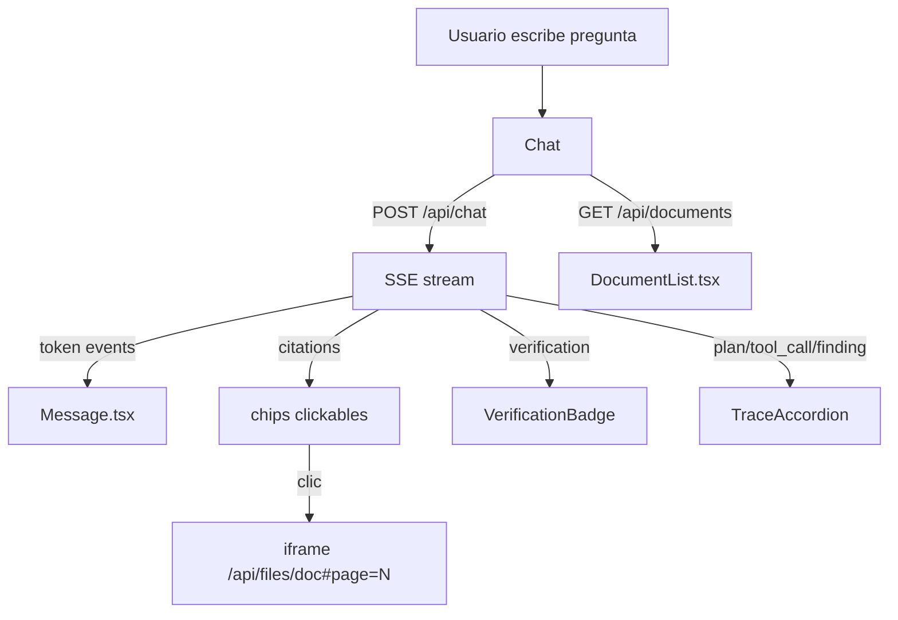

# Frontend — Chat de Relación con Inversionistas

## 1. Qué es (lenguaje de negocio)

Interfaz web que permite a analistas e inversionistas hacer preguntas en lenguaje natural sobre los reportes de relación con inversionistas. Muestra la respuesta del asistente con las cifras exactas, sus fuentes con número de página, el badge de verificación y la traza completa del razonamiento. El visor de PDF abre el documento en la página exacta al hacer clic en una cita.

## 2. Cómo encaja

```
Navegador
  └─ GET /          → frontend/out/ (estático, servido por FastAPI)
  └─ POST /api/chat → SSE stream (FastAPI + LangGraph runner)
  └─ GET /api/documents → lista de DocumentInfo
  └─ GET /api/files/{doc_id} → PDF inline
```

- **Recibe**: eventos SSE del runner (`status`, `plan`, `tool_call`, `tool_result`, `finding`, `verification`, `token`, `citations`, `done`, `error`).
- **Entrega**: render estático en `frontend/out/` que FastAPI sirve en `/`.
- **Habla con**: `backend/app/agents/runner.py` (vía SSE) y `GET /api/documents`.
- Ver también: `docs/api.md`, `docs/agentic-rag.md`.

## 3. Cómo funciona



**Flujo principal:**
1. `useChatStream` (lib/sse.ts) abre un `fetch` POST con `ReadableStream`.
2. Parsea bloques SSE (separados por `\n\n`), extrae `event:` y `data:`.
3. Cada evento actualiza el último mensaje del asistente en el estado de React.
4. `Message.tsx` renderiza el contenido acumulado con `react-markdown + remark-gfm`.
5. Los patrones `[N]` en el markdown se sustituyen por chips clickables que abren `PdfViewer`.

**Modo mock** (`NEXT_PUBLIC_MOCK=1`): `lib/mock.ts` emite 15 eventos canónicos con 150 ms entre cada uno, sin red.

## 4. Decisiones y alternativas descartadas

| Decisión | Alternativa descartada | Razón |
|---|---|---|
| `output: "export"` (estático) | SSR en Cloud Run | Un solo contenedor; FastAPI sirve el estático en `/` sin overhead de Node |
| CSS Modules + variables en `:root` | Tailwind CSS | Tailwind requiere purge y configuración adicional; las variables del SKILL.md se mapean directo a CSS custom properties |
| `react-markdown + remark-gfm` | Componente de tabla propio | Las respuestas LLM ya vienen en Markdown con GFM; remark-gfm maneja tablas, listas y énfasis |
| Fetch + ReadableStream nativo | EventSource | `EventSource` no soporta POST; se necesita cuerpo con `session_id` y `message` |
| Hook `useChatStream` en Chat.tsx | Context global | El chat es una sola pantalla; contexto añade complejidad sin beneficio |
| `system-ui` (sin fuentes externas) | Inter / Geist | SKILL.md lo requiere; elimina dependencia de CDN de Google Fonts |

## 4b. Rediseño UI (aplicado en producción)

Los componentes principales fueron rediseñados con estética moderna manteniendo los colores de marca Banorte:

**Variables CSS añadidas** (`globals.css`):
- `--rojo-light`, `--gris-150`, `--gris-400`, `--shadow-xs/sm/md`, `--radius-sm/md/lg`

**TopBar** (`TopBar.tsx` / `TopBar.module.css`):
- Barra de 60 px con gradiente `--rojo` → `--rojo-oscuro`
- Logo mark "B" como bloque coloreado
- Título "Relación con Inversionistas" + subtítulo "Asistente · Grupo Financiero Banorte"
- Botón de modo oscuro/claro con transición suave

**DocumentList** (`DocumentList.tsx` / `DocumentList.module.css`):
- Cabecera sticky con contador de documentos
- Pills de periodo con fondo `--rojo-light` y borde `rgba(235,0,41,0.18)`
- Hover con borde izquierdo rojo y fondo `--gris-100`
- Emojis por `source_kind` (📊 reporte, 📋 anual, 📑 presentacion, 🎙️ transcripcion, 🏦 estado_financiero)

**Chat** (`Chat.tsx` / `Chat.module.css`):
- Pantalla de bienvenida con icono "B" degradado y subtítulo
- Botón de envío como icono SVG de avión de papel (36×36 px)
- Focus ring rojo en el textarea (`rgba(235,0,41,0.08)`)
- Botón "Detener" con `■` y borde `--gris-200`

## 5. Contrato que toca (SPEC sección API y Eventos SSE)

- `POST /api/chat {session_id, message}` → SSE con eventos `status`, `plan`, `tool_call`, `tool_result`, `finding`, `verification`, `token`, `citations`, `error`, `done`.
- `GET /api/documents` → `list[DocumentInfo]` con campos `doc_id`, `title`, `report_period`, `source_kind`, `pages`.
- `GET /api/files/{doc_id}` → PDF inline; el iframe añade `#page=N` para navegar directamente a la página citada.

## 6. Límites y qué cambiaría en producción

- **Sin rutas de API propias**: `output: "export"` no soporta rutas de API en Next.js; toda la lógica está en el backend Python.
- **Sin rewrites**: el frontend usa rutas relativas (`/api`); en desarrollo se pasa `NEXT_PUBLIC_API_BASE=http://localhost:8000`.
- **Sin autenticación**: la pantalla no tiene login; en producción se añadiría un middleware en FastAPI o un proveedor OAuth.
- **Sin SSR ni ISR**: las páginas son completamente estáticas; datos dinámicos (lista de documentos) se cargan en cliente.
- **iframe PDF**: los navegadores móviles pueden no soportar visualización inline de PDFs; en producción se consideraría un lector PDF JS.

## 7. Cómo probarlo

```bash
# Modo mock (sin backend): verifica traza, badge y tabla en la conversación
cd frontend
NEXT_PUBLIC_MOCK=1 npm run dev
# abrir http://localhost:3000, hacer clic en una sugerencia

# Build de producción
npm run build
# frontend/out/index.html debe existir

# Ancho 390 px: usar DevTools → modo responsivo 390×844

# Contra la API real (C4)
NEXT_PUBLIC_API_BASE=http://localhost:8000 npm run dev
# asegurarse de que el backend esté corriendo: make api
```

**Compuerta verificada:**
- `npm run build` sin errores: ✓
- `frontend/out/index.html` existe: ✓
- Con `NEXT_PUBLIC_MOCK=1`: muestra traza, badge "Verificado" y tabla markdown: ✓
- A 390 px: layout apilado funcional: ✓
