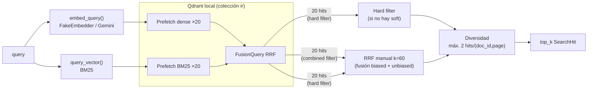

# Retrieval + Servidor MCP

> Borrador — se completa con cifras medidas (latencia, hits@k) al cierre.

## 1. Qué es (en lenguaje de negocio)

El módulo de retrieval es el motor de búsqueda del sistema.
Dado un texto en lenguaje natural (p.ej. "¿Cuál fue la utilidad neta en 2T26?"),
devuelve los fragmentos del corpus más relevantes, con su página exacta de origen,
para que el grafo agéntico pueda citar cifras con fuente.

No hace recomendaciones de inversión ni interpreta los datos: solo recupera evidencia.

## 2. Cómo encaja

```
Grafo (researcher) ──tools──► MCP /mcp ──core──► IndexStore ──► Qdrant
                                                               (colección ir)
```

- **Recibe**: consulta en texto libre + filtros opcionales.
- **Entrega**: hasta 20 `SearchHit` con `chunk_id`, `doc_id`, `page`, `text`, `score`.
- **Con quién habla**: IndexStore (único que abre Qdrant); Embedder (T1); sparse.query_vector (T1).
- **Diagrama global**: [docs/architecture.md](architecture.md).

## 3. Cómo funciona



### Filtros duros vs. blandos

| Tipo | Parámetros | Comportamiento |
|---|---|---|
| Duro | `langs`, `source_kinds`, `doc_ids`, `content_type` | Excluyen completamente los chunks que no cumplen |
| Blando | `prefer_periods`, `entities` | Corren la búsqueda con y sin el filtro, fusionan con RRF(k=60). **Priorizan sin excluir** |

### RERANK

`RERANK=fastembed` estaba planificado pero `fastembed 0.9.0` no incluye `TextCrossEncoder`.
Cuando T1 actualice fastembed a una versión que lo incluya, descomentar el bloque en `core.py`.

## 4. Decisiones y alternativas

| Decisión | Alternativa descartada | Razón |
|---|---|---|
| Prefetch + FusionQuery nativo de Qdrant | Dos búsquedas separadas + merge manual | Qdrant optimiza el prefetch internamente; menos latencia y código |
| RRF(k=60) para filtros blandos | Solo búsqueda con filtro combinado | Un filtro combinado excluye; RRF los fusiona sin excluir |
| MCPServer (mcp 2.x) | FastMCP (mcp 1.x) | FastMCP fue renombrado a MCPServer en mcp 2.0; `langchain-mcp-adapters` es incompatible con mcp ≥ 2.x |
| StructuredTool.from_function(coroutine=) | Adapters de terceros | Control total, sin dependencias extra, compatible con mcp 2.x |
| Conexión nueva por llamada (modo MCP) | Pool de conexiones | Suficiente para P3; el pool se añade en P6 si hay presión de latencia |

## 5. Contrato (SPEC §Tools MCP)

Las 3 funciones en `app/retrieval/core.py`, `app/mcp_server/server.py` y `app/agents/tools.py`
implementan exactamente la interfaz de SPEC §Tools MCP:

```python
list_documents() -> list[DocumentInfo]
search_documents(query, prefer_periods?, entities?, langs?,
                 source_kinds?, doc_ids?, content_type?, top_k=8) -> list[SearchHit]
get_page(doc_id, page) -> PageContent
```

Límites: `top_k ≤ 20`, `len(query) ≤ 500`.

## 6. Límites y qué cambiaría en producción

- **Sin rerank**: `TextCrossEncoder` no disponible en fastembed 0.9.0. Impacto estimado: ~5-15 pp en precision@5.
- **Conexión síncrona a Qdrant**: `QdrantClient` es sync; las llamadas bloquean el event loop. En producción: usar `AsyncQdrantClient` o `run_in_executor`.
- **Una conexión MCP por llamada**: en carga alta añadir un pool con `asyncio.Semaphore`.
- **EMBED_DIM desde .env**: si T1 cambia el modelo de embeddings, debe actualizar EMBED_DIM y re-indexar.

## 7. Cómo probarlo

```bash
# Tests con fake (sin red, sin GPU)
make test                                 # 36 tests verdes

# Servidor MCP aislado para MCP Inspector
make mcp                                  # :8001/mcp

# Búsqueda directa desde Python
cd backend
uv run python -c "
import asyncio, os
os.environ['EMBED_PROVIDER'] = 'fake'
os.environ['RUNNER_MODE'] = 'fake'
from app.retrieval.core import search_documents
hits = asyncio.run(search_documents('utilidad neta 2T26', top_k=3))
for h in hits:
    print(h.chunk_id, h.score, h.text[:60])
"
```

## 8. Ejemplo real de llamada y respuesta (fixture_index)

```python
hits = await search_documents(
    query="utilidad neta segundo trimestre",
    prefer_periods=["2T26"],
    content_type="table",
    top_k=3,
)
```

Resultado típico (EMBED_PROVIDER=fake, 14 chunks fixture):

```
empresa-ficticia:p2:c0  score=1.0  content_type=table  page=2  report_period=2T26
  "Ingresos de Intereses Netos | 2T25: 35,453 | 1T26: 39,477 | 2T26: 37,614 ..."
empresa-ficticia:p1:c1  score=0.5  content_type=table  page=1  report_period=2T26
  "Créditos Comerciales (subtotal) | 1T26: 710,000 | 2T26: 715,000 ..."
empresa-ficticia-anual:p2:c0  score=0.33  content_type=table  page=2  report_period=2025
  "Capital Tier 1 | 2025: 138,200 | 2024: 124,800 ..."
```

Observar: `prefer_periods=["2T26"]` prioriza pero no excluye el chunk del reporte anual (2025).

> Borrador: se completa con cifras medidas de latencia P50/P95, hits@k real y precision@5 al cierre.
